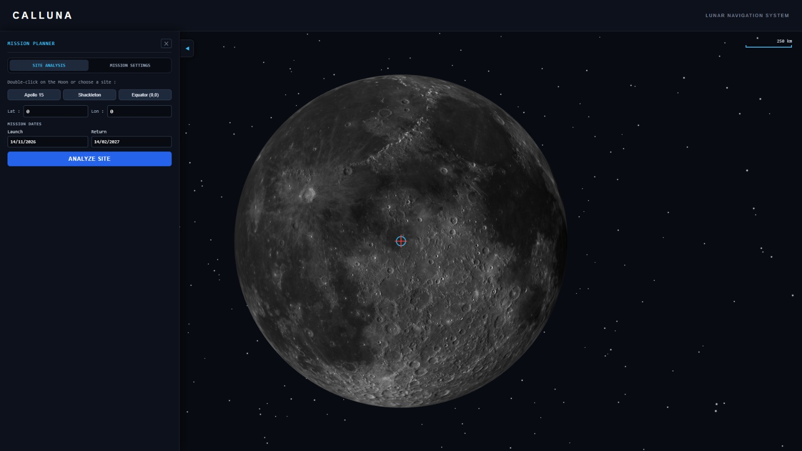
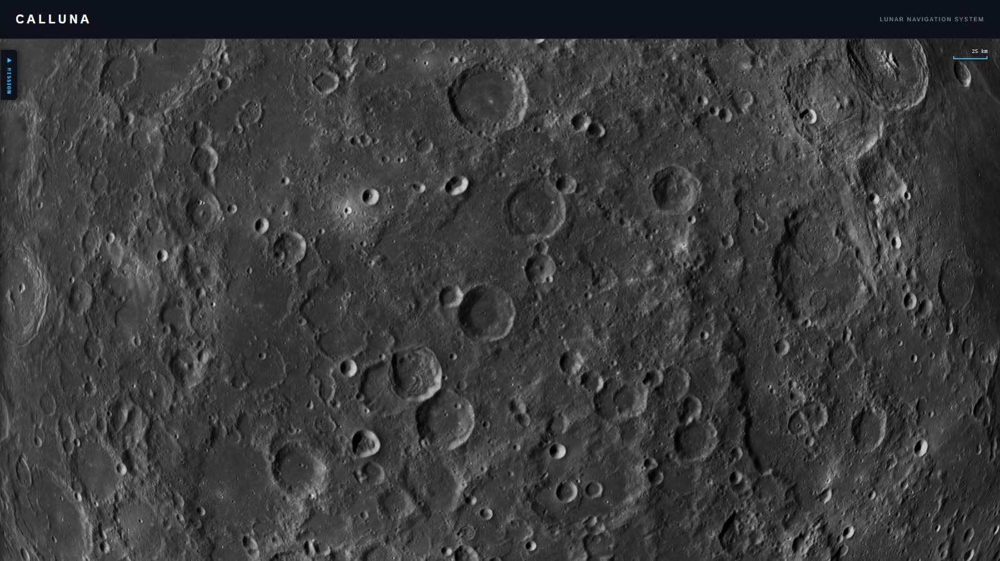
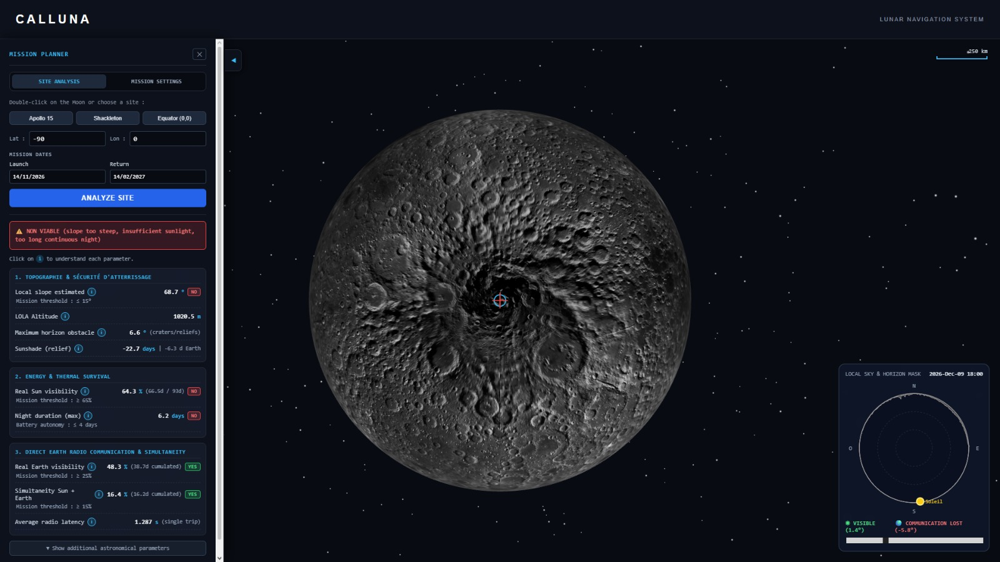
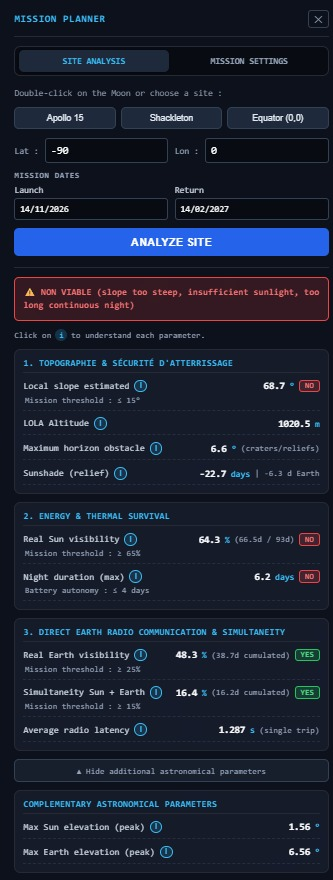
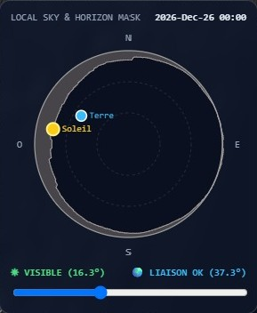

# CALLUNA — Lunar Navigation & Mission Planner

**Explore the Moon. Analyse landing sites. Plan lunar missions.**

CALLUNA is an interactive lunar exploration and mission-planning application developed for the **NASA Space Apps Challenge 2026**.

It combines high-resolution lunar imagery, terrain data, and astronomical calculations to help users evaluate potential lunar landing sites.



## Features

- **Interactive 3D Moon** — Rotate, zoom, and explore the lunar surface using NASA imagery.
- **Landing-site selection** — Double-click anywhere on the Moon or enter lunar coordinates.
- **Terrain analysis** — Examine elevation, slope, and surrounding terrain.
- **Sunlight analysis** — Estimate solar illumination and periods without sunlight.
- **Earth visibility** — Evaluate opportunities for direct communication with Earth.
- **Mission timeline** — Visualise changing conditions during a selected mission period.
- **Custom mission criteria** — Adjust thresholds to evaluate landing-site suitability.



## Installation

### Requirements

- Windows computer
- Python 3 installed and available in PATH
- Internet connection
- Modern browser with WebGL support

**Node.js, npm, and programming knowledge are not required.** The frontend is already compiled.

### Getting started

1. Download the project ZIP from GitHub.
2. Extract the entire ZIP into a folder.
3. Install Python from [python.org](https://www.python.org/downloads/) if necessary.
4. Double-click **`Lancer_Calluna.bat`** in the main project folder.
5. Wait for CALLUNA to open in your browser.

The launcher automatically creates a Python environment, installs the required dependencies, and starts the application.

**The first launch may take a while.** Subsequent launches should be faster.

If the browser does not open automatically, visit:

**http://localhost:8000**

Keep the launcher terminal open while using CALLUNA.

## How to Use CALLUNA

### 1. Explore the Moon

Left-click and drag to rotate the Moon. Use your mouse wheel to zoom in and out.

Higher-resolution NASA imagery loads as you approach the lunar surface.

You can explore the equatorial regions, historic landing sites, and lunar poles.



### 2. Select a landing site

Choose a location using one of three methods:

- Double-click directly on the Moon.
- Enter latitude and longitude in the Mission Planner.
- Select a predefined site, such as Apollo 15 or Shackleton.

A crosshair marks the selected location.

Double-clicking updates the coordinates without automatically starting an analysis.

### 3. Run a mission analysis

1. Select your landing site.
2. Choose the mission start and end dates.
3. Click **ANALYZE SITE**.
4. Wait for the analysis to finish.

CALLUNA evaluates the selected location using terrain and astronomical data.



### 4. Understand the results

The analysis provides indicators such as:

| Indicator | What it tells you |
|---|---|
| Terrain slope | How steep the local surface is |
| Sunlight availability | How often the site receives direct sunlight |
| Maximum darkness | Longest estimated period without sunlight |
| Earth visibility | How often direct communication with Earth may be possible |
| Simultaneous visibility | How often both the Sun and Earth are visible |
| Mission suitability | Whether the site meets the selected mission thresholds |

You can adjust mission thresholds to explore different requirements.

### 5. Explore the mission timeline

Use the timeline controls to examine conditions throughout the selected mission period.

CALLUNA visualises the changing positions of the Sun and Earth, helping you understand how illumination and communication opportunities evolve.



## Scientific Data Sources

CALLUNA uses data and services from NASA and associated research organisations:

- [NASA Moon Trek](https://trek.nasa.gov/moon/) — Lunar imagery and mapping
- [Lunar Reconnaissance Orbiter](https://science.nasa.gov/mission/lro/) — Lunar surface observations
- [LOLA PDS Data Archive](https://imbrium.mit.edu) — Lunar elevation data
- [NASA JPL Horizons](https://ssd.jpl.nasa.gov/horizons/) — Sun and Earth ephemerides

**Disclaimer:** CALLUNA is intended for educational exploration and preliminary mission assessment. It is not a certified system for real lunar landing operations.

## Project Structure

```text
NSA_Hackathon/
├── README.md
├── Lancer_Calluna.bat
├── screenshots/
│   ├── overview.png
│   ├── lunar-surface.png
│   ├── south-pole.png
│   ├── mission-analysis.png
│   └── mission-timeline.png
├── calluna/
│   ├── dist/
│   └── README.md
└── backend/
    ├── api_mission.py
    ├── requirements.txt
    └── README.md
```

For technical documentation:

- **Frontend:** `calluna/README.md` — React, Three.js, lunar imagery, coordinates, and UI architecture.
- **Backend:** `backend/README.md` — FastAPI, terrain processing, NASA Horizons, and mission calculations.

## Troubleshooting

**The application doesn't start:** Verify that Python is installed using `python --version`.

**The browser doesn't open:** Keep the launcher running and manually visit http://localhost:8000.

**The Moon is initially black or blurry:** Wait for the 3D scene and NASA imagery to finish loading.

**Mission analysis fails:** Check your internet connection and ensure the launcher terminal is still running.

**Results don't update after selecting another site:** Click **ANALYSER CE SITE** to run a new analysis.

## AI Usage Disclosure

Generative AI tools, including ChatGPT, were used throughout the development of CALLUNA.

AI assistance contributed to frontend and backend code, software architecture, debugging, and documentation. (All source code in this repository should be considered AI-assisted.)

The CALLUNA team directed the development, integrated the components, tested the application, and refined its functionality.

## Acknowledgments

Developed for the **NASA Space Apps Challenge 2026**, using publicly available scientific resources from NASA, LRO/LOLA, Moon Trek, and JPL Horizons.

CALLUNA is an independent project and is not an official NASA mission-planning application.

---

**CALLUNA — Explore the Moon. Understand the environment. Plan the mission.**
